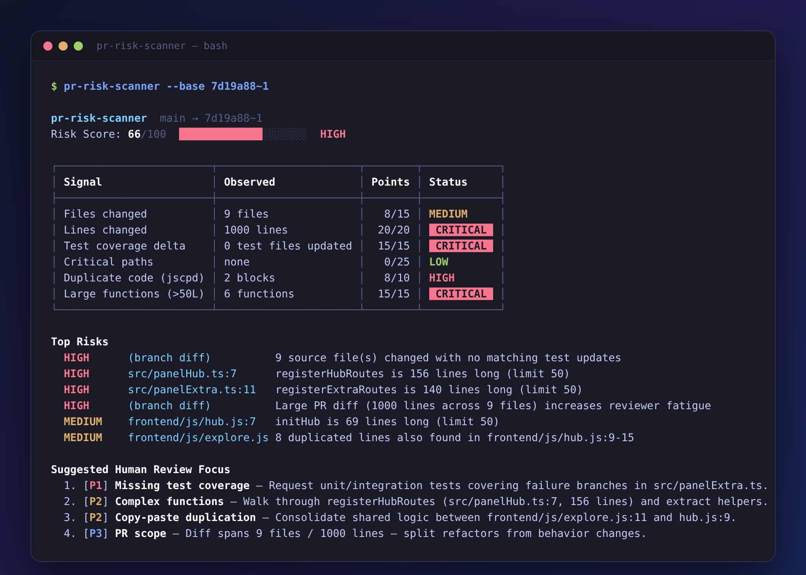

# pr-risk-scanner

[](https://github.com/AYUSH-PANDEY023/pr-risk-scanner/actions/workflows/ci.yml)

Local-first Node.js CLI that scores pull request risk (`0–100`) from your git diff, TypeScript/JavaScript AST, and copy-paste detection. Runs completely offline with no external APIs or keys.

<p></p>

## Why

Large PRs—especially ones with heavy generated or refactored code—hide risky changes behind noisy diffs. `pr-risk-scanner` gives reviewers a fast, deterministic signal before reading a single line: how big the diff is, whether tests were updated, whether sensitive paths were touched, and where oversized functions, risky patterns, or duplicated blocks crept in.

## Install

### Direct from GitHub

```bash
npm install -g github:AYUSH-PANDEY023/pr-risk-scanner
```

### Local Clone

```bash
git clone https://github.com/AYUSH-PANDEY023/pr-risk-scanner.git
cd pr-risk-scanner
npm install
npm run build
npm link
```

Requires Node.js `>=18`.

## Usage

Run from inside any git repository on a feature branch:

```bash
pr-risk-scanner
```

### CLI Options

| Flag | Description | Default |
| --- | --- | --- |
| `-b, --base <branch>` | Base branch or ref to diff against (falls back to `origin/<branch>`) | `main` |
| `-c, --config <path>` | Path to a custom JSON config file | `pr-risk.config.json` |
| `--staged` | Scan staged changes (`git diff --cached`) instead of branch diff | `false` |
| `--max-fn-lines <n>` | Line threshold for flagging large functions via `ts-morph` | `50` |
| `--threshold <n>` | Score (`0–100`) at or above which `--ci` exits with code `1` | `70` |
| `--ci` | CI mode: exit `1` when risk score meets or exceeds threshold | `false` |
| `--markdown` | Output GitHub-flavored Markdown report for PR comments | `false` |
| `--json` | Output raw JSON report instead of the terminal table | `false` |
| `--init` | Generate a starter `pr-risk.config.json` in the current directory | `false` |

### Examples

```bash
# Diff against develop instead of main
pr-risk-scanner --base develop

# Check staged changes before committing
pr-risk-scanner --staged

# Output Markdown for a GitHub PR comment
pr-risk-scanner --markdown

# Gate CI builds on score >= 65
pr-risk-scanner --ci --threshold 65

# Pipe structured output into jq
pr-risk-scanner --json | jq '.topRisks'
```

## Scoring Model

Scores are capped at `100` and split across seven deterministic signals (all weights customizable in `pr-risk.config.json`):

| Signal | Default Weight | How It Works |
| --- | ---: | --- |
| Files changed | 12 | Counts non-ignored files in the three-dot diff (`base...HEAD`) |
| Lines changed | 18 | Sums insertions + deletions (lockfiles and build output ignored) |
| Test coverage delta | 15 | Flags production code diffs (`>=15` lines) with zero test file changes |
| Critical paths | 20 | Segment-aware matching for `/auth`, `/payments`, `/migrations` (avoids false positives like `/author`) |
| Duplicate code | 10 | Runs `jscpd` (`v4`) and reports only clones touching changed PR files |
| Large functions | 12 | Diff-hunk-aware `ts-morph` AST scan flagging oversized functions touched in this PR |
| Risky code patterns | 13 | Flags empty `catch {}`, `eval()`, `new Function()`, `child_process.exec()`, and `dangerouslySetInnerHTML` in changed lines |

Risk levels: `0–29` **LOW**, `30–59` **MEDIUM**, `60–79` **HIGH**, `80–100` **CRITICAL**.

## Configuration

Run `pr-risk-scanner --init` or add a `pr-risk.config.json` (or `.pr-riskrc.json`) at your repository root:

```json
{
  "baseBranch": "main",
  "failThreshold": 70,
  "criticalPaths": ["/auth", "/payments", "/migrations"],
  "maxFunctionLines": 50,
  "duplicateMinLines": 6,
  "duplicateMinTokens": 50,
  "weights": {
    "filesChanged": 12,
    "linesChanged": 18,
    "missingTests": 15,
    "criticalPaths": 20,
    "duplicateCode": 10,
    "largeFunctions": 12,
    "riskyPatterns": 13
  }
}
```

## GitHub Actions PR Comment Example

```yaml
name: PR Risk Check
on: [pull_request]

permissions:
  pull-requests: write

jobs:
  risk-scan:
    runs-on: ubuntu-latest
    steps:
      - uses: actions/checkout@v4
        with:
          fetch-depth: 0
      - uses: actions/setup-node@v4
        with:
          node-version: 20
      - run: npm install -g github:AYUSH-PANDEY023/pr-risk-scanner
      - name: Scan and comment on PR
        env:
          GH_TOKEN: ${{ secrets.GITHUB_TOKEN }}
        run: |
          pr-risk-scanner --base ${{ github.base_ref }} --markdown > risk-report.md
          gh pr comment ${{ github.event.pull_request.number }} --body-file risk-report.md
          pr-risk-scanner --base ${{ github.base_ref }} --ci --threshold 75
```

## Development

```bash
npm install
npm run typecheck
npm test
npm run build
```

## License

[MIT](./LICENSE)
